<p align="center">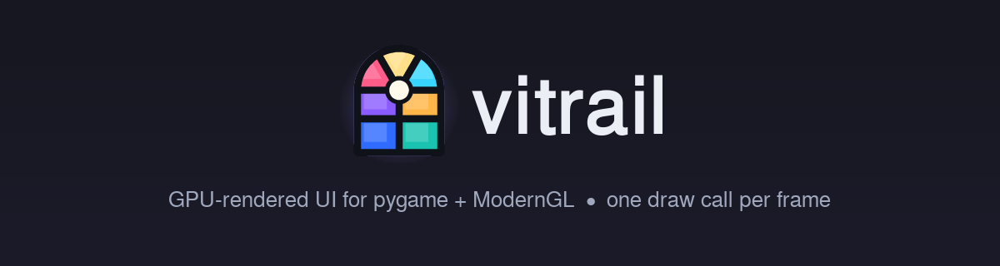</p>

**Vitrail** (French for *stained-glass window*) is a GPU-rendered UI toolkit for
**pygame + ModernGL**. Every pane of the interface is a lit piece of glass:
the whole UI is drawn with **one instanced draw call per frame**. It is
written from scratch, Apache-2.0 licensed, and runs on **Linux, Windows and
macOS**.

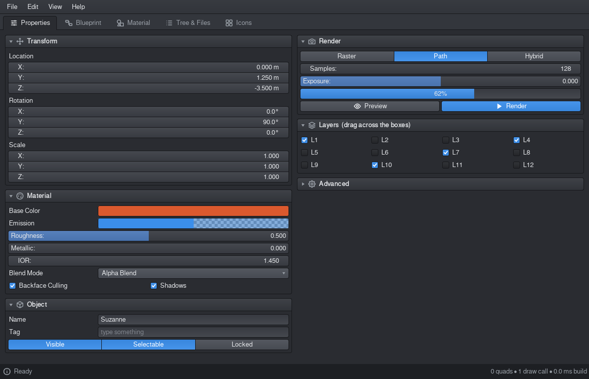

| | |
|---|---|
| 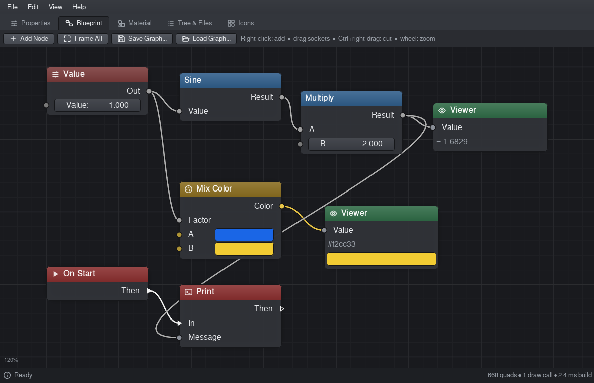 **Blueprint node editor** | 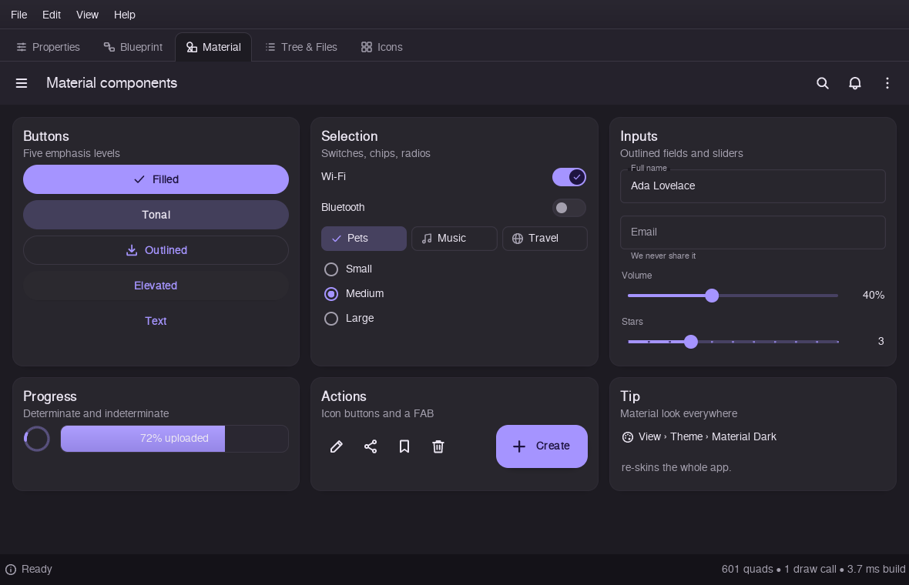 **Material components** |
| 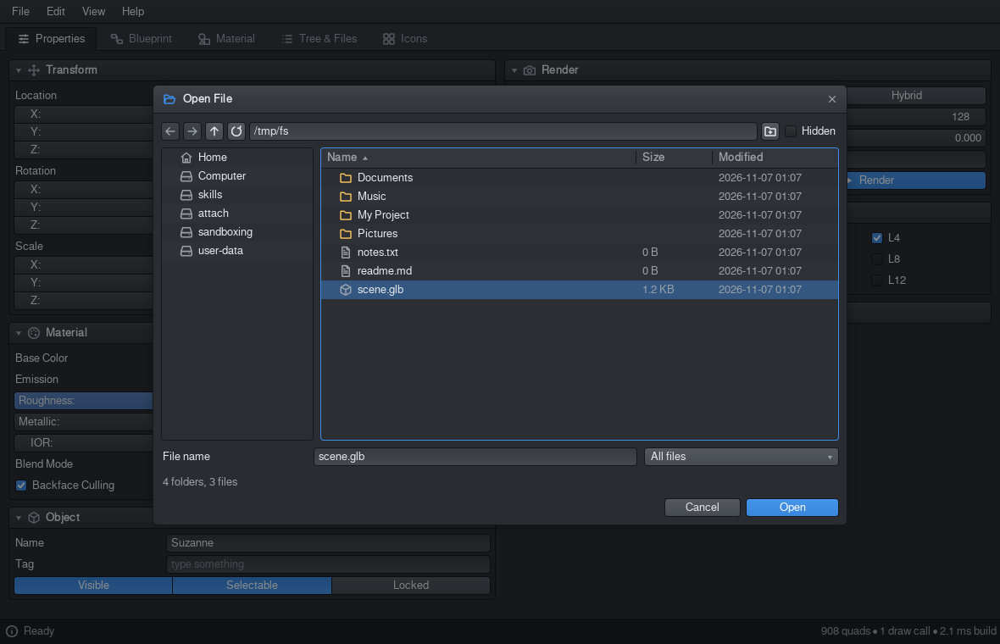 **File dialog** (in-app, cross-platform) | 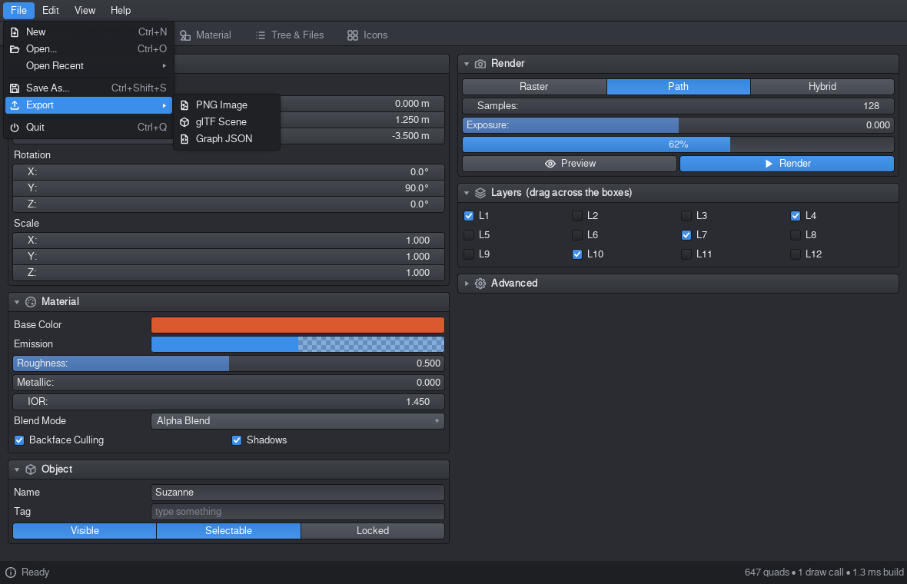 **Menu bar, submenus, shortcuts** |
| 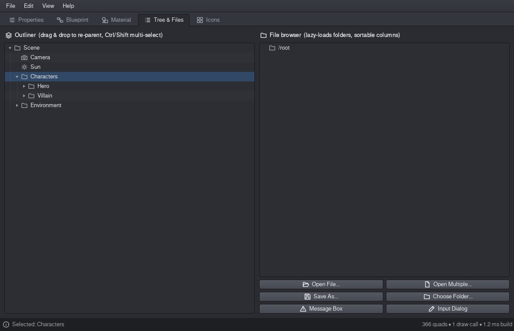 **Tree view / outliner** | 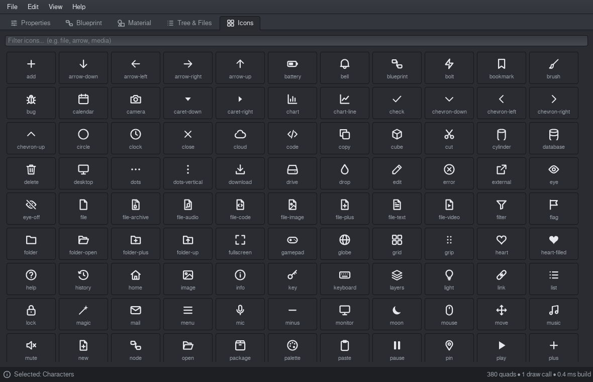 **147 built-in vector icons** |
| 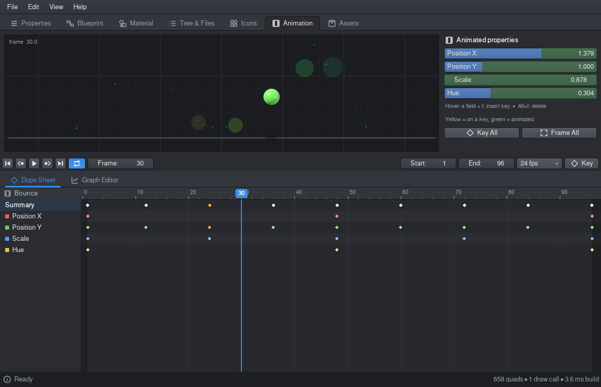 **Animation: dope sheet + transport** | 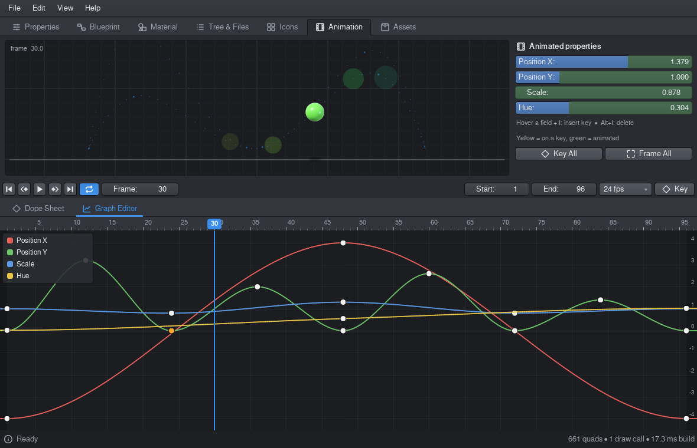 **Animation: graph editor** |
| 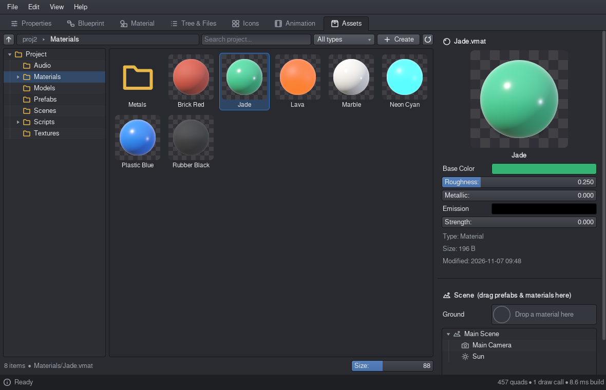 **Asset browser with material balls** | 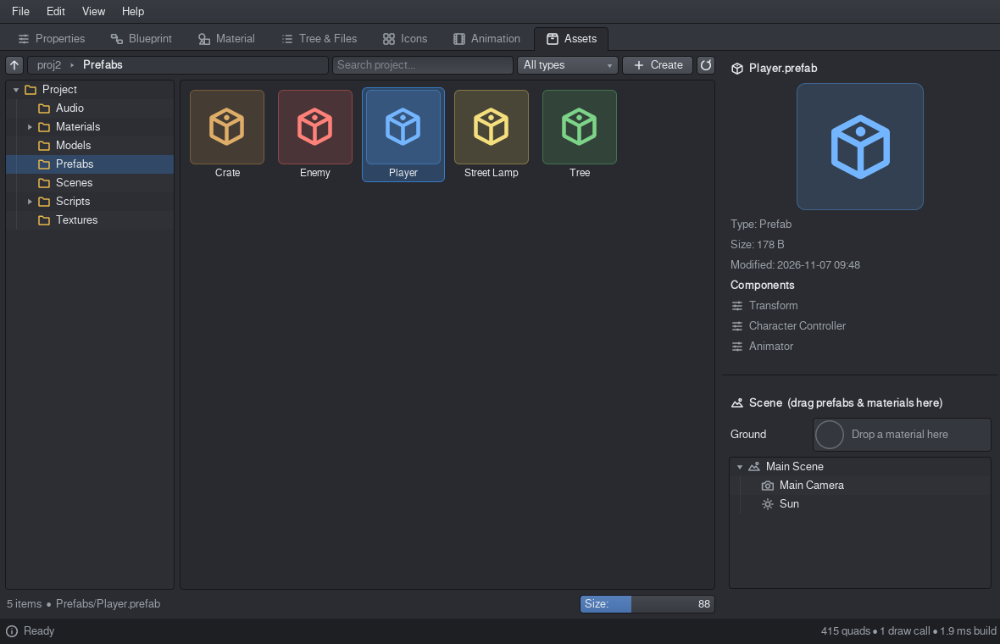 **Prefabs, inspector, drag & drop** |

## What's inside

| Area | Highlights |
|---|---|
| **Renderer** | Rounded boxes, borders, gradients, shadows, glyphs, icons, wires, grid, colour wheels and ripples are all instances of one quad and one SDF shader. Clipping is per instance, so there are no batch breaks. Unchanged widgets are copied back from a per-widget paint cache with one memcpy, and nothing is rendered while the UI is idle. |
| **Icons** | 147 original vector icons: files, folders, media, editing, arrows, status, devices, 3D. Each is rasterised once per size into the atlas and drawn as 1 quad with any tint. `register_icon()` adds your own. |
| **Widgets** | Label, Button (icon + text), Checkbox, Toggle, NumberField (drag to scrub, type math, Ctrl/Shift), VectorField, TextField, Dropdown (searchable), EnumRow, ColorSwatch and picker, ProgressBar, Panel, Tabs, ScrollArea, PieMenu |
| **Menus** | `MenuBar`, cascading submenus, icons, check items, shortcuts (`"Ctrl+Shift+S"`), keyboard navigation. Typing in any open menu searches every submenu and tolerates typos. Also context menus. |
| **Tree view** | Virtualised (100 000 rows scroll smoothly), columns with click-to-sort, lazy children, Ctrl/Shift multi-select, arrow-key navigation, type-ahead, drag & drop re-parenting |
| **Dialogs** | Modal `Dialog`, `MessageBox`, `InputDialog`, and **`FileDialog`**: open, open-multiple, save (with overwrite confirmation), choose folder. It has places, drives, history, filters, a hidden-files toggle, new folder and sortable columns. |
| **Blueprint** | `NodeEditor`: typed sockets, bezier wires, exec pins, connect / re-route / detach, a cycle guard, a knife cut tool, box select, move, duplicate, delete, undo, zoom and pan, a searchable add-node menu, `evaluate()`, and `to_dict()` / `from_dict()`. Live Vitrail widgets inside nodes scale with the zoom. |
| **Material** | `MButton` (filled / tonal / outlined / elevated / text) with real ripples, `FAB`, `IconButton`, `Switch`, `Chip`, `RadioGroup`, `Slider`, `Card`, `AppBar`, `OutlinedField` (floating label), `Spinner`, `Snackbar`. Comes with `Theme.material_dark()` and `Theme.material_light()`. |
| **Animation** | `Clip` / `Track` / `Keyframe` (constant, linear, bezier with auto-clamped tangents) and an `AnimationPlayer` with loop, fps and speed. `Timeline` is a dope sheet: scrub, select, box-select, drag keys, interpolation menu, summary row. `CurveEditor` is a graph editor: drag keys in time and value, hide channels from the legend. `TransportBar` holds the playback controls. Bound widgets follow the animation; press **I** over a field to key it, and keyed fields are tinted. |
| **Assets** | `AssetBrowser` works like a Unity / Blender project panel over a real folder. It has a folder tree, breadcrumbs, fuzzy search across the whole project, type filter, and a thumbnail-size slider that switches to a list. Thumbnails are real image previews, **GPU-shaded material balls** (`.vmat`), prefab cubes and typed icons. You can create folders, materials and prefabs, rename, duplicate, delete, reveal in the file manager, and drag assets into folders or onto `MaterialSlot` and scene trees. `MaterialEditor` edits a material and saves it live. |
| **Everything** | Undo/redo (a whole drag is one step), clipboard, tooltips, themes (`dark`, `light`, `material_dark`, `material_light`), HiDPI `scale`, and a safe expression evaluator |

## Install & run

```bash
pip install moderngl pygame          # or pygame-ce
pip install -e .
python examples/demo.py              # the full showcase (menu bar + 7 pages)
python examples/game_overlay.py      # Vitrail floating over your own ModernGL scene
```

It needs OpenGL 3.3 core, which covers any GPU from the last ~12 years and Mesa.

## A taste

```python
import vitrail as vt
from vitrail.material import MButton, Switch, Snackbar

app = vt.App(1000, 700, "My tool", root="fill")
ui = app.ui
MI = vt.MenuItem

app.root.add(vt.MenuBar([
    ("File", [MI("Open...", lambda: vt.FileDialog.open_file(ui, print, filters=[("Images", "*.png;*.jpg")]),
                 icon="folder-open", shortcut="Ctrl+O"),
              MI("Export", submenu=[MI("PNG", lambda: print("png"), icon="file-image")]),
              None,
              MI("Quit", app.quit, shortcut="Ctrl+Q")]),
]))

tabs = vt.Tabs(fill=True, parent=app.root)
with tabs.tab("Object", icon="cube"):
    with vt.Panel("Transform", icon="move"):
        vt.VectorField("Location", (0.0, 0.0, 0.0), step=0.1, unit=" m")
        vt.NumberField("Roughness", 0.5, min=0, max=1, slider=True)
    MButton("Save", lambda: Snackbar.show(ui, "Saved", ("Undo", ui.undo.undo)), icon="save")
    Switch("Auto-save", True)

with tabs.tab("Outliner", icon="list"):
    vt.TreeView([vt.TreeItem("Scene", [vt.TreeItem("Camera", icon="camera"),
                                       vt.TreeItem("Light", icon="light")], expanded=True)],
                drag_drop=True, fill=True)
app.run()
```

### Blueprint graph

```python
from vitrail.nodes import NodeEditor, Node

ed = NodeEditor(fill=True, parent=page)
ed.register("Math/Add", lambda: Node("Add", category="math",
            inputs=[("A", "float", 0.0), ("B", "float", 0.0)], outputs=[("Result", "float")],
            compute=lambda i: {"Result": i["A"] + i["B"]}))
a = ed.add_node(ed.create("Math/Add"), (40, 60))
ed.graph_changed.connect(lambda: print(ed.evaluate(a)))
```

Socket types are `float int bool vector color string exec object any`. Inputs
that have a default get an inline editor, which hides itself once something is
connected. See `examples/blueprint_nodes.py` for 23 ready-made nodes.

### Animation

```python
from vitrail.animation import Clip, AnimationPlayer, Timeline, CurveEditor, TransportBar

clip = Clip("Bounce", start=1, end=96, fps=24)
height = clip.add_track("Height", keys=[(1, 0.0), (24, 3.0), (48, 0.0)])
player = AnimationPlayer(clip).attach(ui)       # Space = play/pause, I = key hovered field
field = vt.NumberField("Height", 0.0, parent=panel)
player.bind(height, field)                      # the field follows the animation
TransportBar(player, parent=page)
Timeline(player, parent=page)                   # dope sheet
CurveEditor(player, fill=True, parent=page)     # graph editor
player.frame_changed.connect(lambda f: print("frame", f))
```

The timeline and graph editor redraw only while something moves. During
playback the UI renders at display rate; when playback stops it goes back
to rendering nothing.

### Asset browser (project panel)

```python
from vitrail.assets import AssetBrowser, MaterialEditor, MaterialSlot

browser = AssetBrowser("path/to/project", fill=True, parent=page)
browser.selection_changed.connect(lambda assets: print([a.name for a in assets]))
browser.activated.connect(lambda asset: open_asset(asset.path))   # double-click / Enter
slot = MaterialSlot(label="Surface", parent=inspector)            # drop a .vmat here
```

Each asset has `kind` (`folder material prefab image mesh scene anim audio
video script shader font text other`), `path`, `size`, `mtime`, and `data`
(parsed JSON for materials and prefabs). Dragging assets produces a
`{"type": "asset", "assets": [...]}` payload. Any widget becomes a drop
target by implementing `accepts_drop(payload)` and
`on_drop(ui, payload, x, y)`, and `TreeView` has `drop_filter` and
`payload_dropped`. `examples/sample_project` (regenerate it with
`make_sample_project.py`) includes materials, metals, prefabs, textures,
models, scripts, shaders, audio and a scene.

`DrawList.material_ball()` and `DrawList.image()` are one quad each. Colour
images come from a second RGBA atlas, which is drawn in the same draw call,
so `vitrail.images.Image` can show any PNG or JPG.

### File dialogs

```python
vt.FileDialog.open_file(ui, on_done, filters=[("Images", "*.png;*.jpg"), ("All files", "*")])
vt.FileDialog.open_file(ui, on_done, multiple=True)
vt.FileDialog.save_file(ui, on_done, default_name="scene.json", filters=[("Scene", "*.json")])
vt.FileDialog.choose_folder(ui, on_done)
vt.MessageBox.ask(ui, "Delete it?", on_done, buttons=("Cancel", "Delete"), icon="warning", cancel="Cancel")
vt.InputDialog.ask(ui, "Rename", "Name", on_done, default="Cube")
```

The dialogs never block your loop. `on_done` receives a path, a list of
paths, or `None`. They work the same on every OS because they use only
`os`/`pathlib`: drive letters and the *hidden* attribute on Windows,
dot-files and localised XDG folders on Linux, and `/Volumes` on macOS.
Keyboard: `Backspace` / `Alt+↑` goes to the parent folder, `Alt+←/→` goes
back and forward, `F5` reloads, `Ctrl+H` toggles hidden files, `Ctrl+L`
edits the path, and typing jumps to a file.

## Using it inside your own game loop

```python
ui = vt.UI(ctx, (w, h))                    # ctx = moderngl.create_context()
canvas = ui.set_root(vt.Canvas())          # transparent root: missed clicks fall through
...
for e in pygame.event.get():
    if not ui.handle_event(e):             # False -> the event is the game's
        game_input(e)
draw_scene()
ui.update(); ui.draw()                     # one draw call, buffer re-uploaded only on change
pygame.display.flip()
```

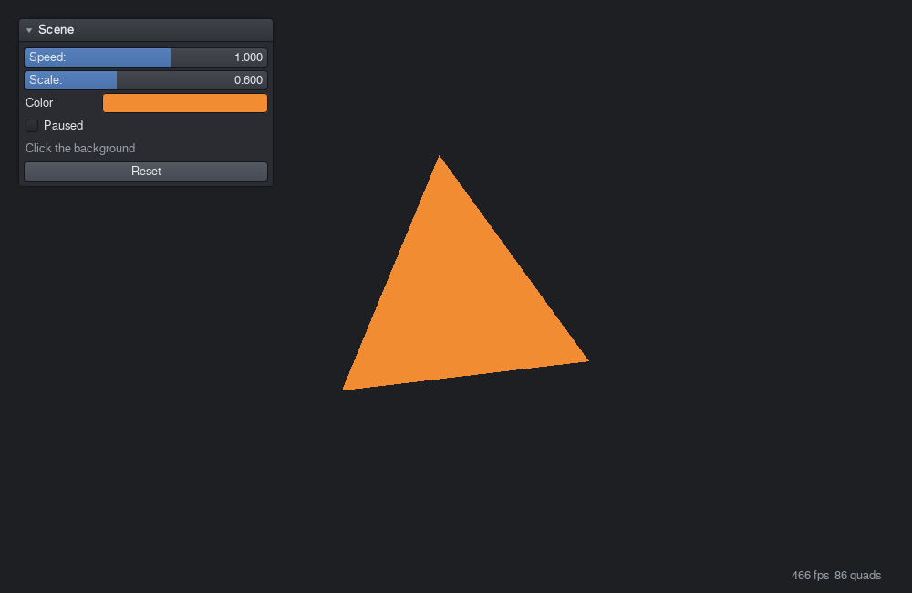

## Logo

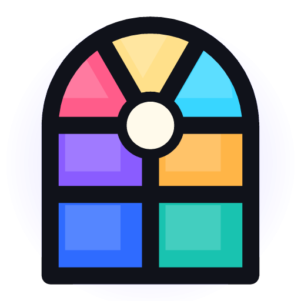

The logo is an arched stained-glass window: four panes and a three-petal
rose of glass held by dark lead lines, with a bright jewel where the light
comes through. `vitrail.logo` renders it as SVG (`logo_svg()`), as a pygame
surface (`logo_surface(px)`, which `App` uses as the window icon) or inside
the UI (`draw_logo`). The vector source is `docs/logo.svg`.
<br clear="left">

## Tests

```bash
pip install pytest
python -m pytest tests     # 68 tests, headless through EGL
```

The tests drive the real UI with synthetic input. They cover scrubbing,
undo, menus and submenus, shortcuts, tree keyboard and drag & drop, file
dialog flows (filter, navigate, multi-select, overwrite confirmation, new
folder), node linking, cycles, knife cuts, zoomed widgets, serialisation,
Material widgets, every icon, every theme, animation (interpolation, playback, keying,
timeline and graph editing) and the asset browser (navigation, search, create, rename,
delete, drag & drop into folders, slots and trees, thumbnails).

## Author

Created by **S.U.P.E**, also known as **Hamid Reza Jahanshahi**.

## License

Copyright 2026 Hamid Reza Jahanshahi (S.U.P.E).

Licensed under the Apache License, Version 2.0. See [LICENSE](LICENSE) and [NOTICE](NOTICE).
